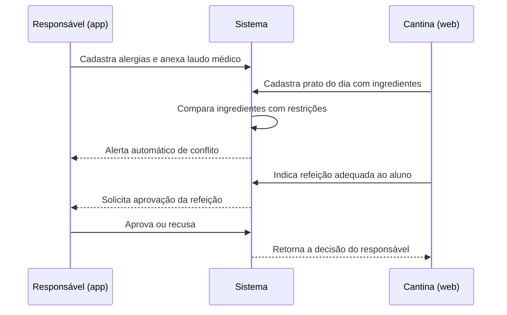
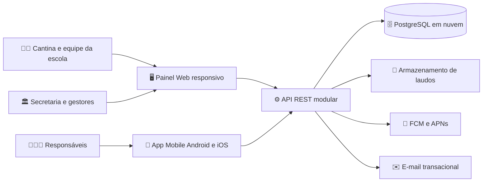
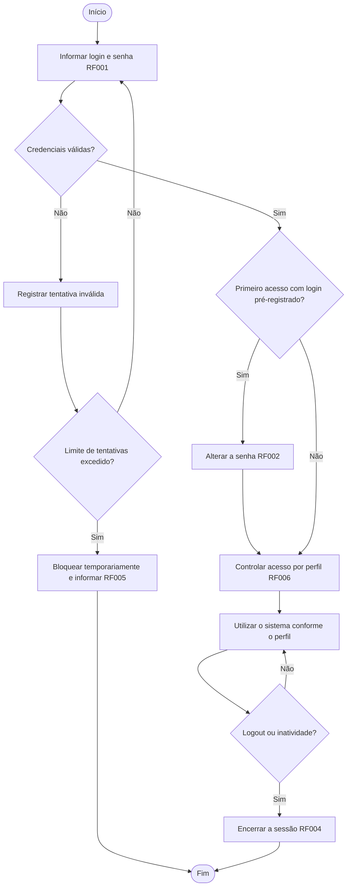
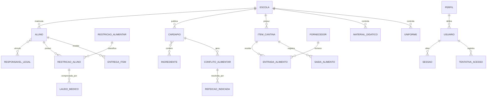

<div align="center">


**Gestão integrada de cantina, materiais didáticos e uniformes das escolas municipais de Saquarema/RJ, com controle individualizado de alergias e restrições alimentares integrado ao cardápio.**

<br>


**Stack planejada**


-000020?style=flat-square&logo=expo&logoColor=white)


<br>

[📖 Sobre](#-sobre-o-projeto) ·
[⚠️ Problema](#️-o-problema) ·
[🎯 Objetivos](#-objetivos-e-metas) ·
[✨ Funcionalidades](#-funcionalidades) ·
[👥 Usuários](#-usuários-e-perfis) ·
[🔄 Fluxos](#-como-o-sistema-funciona) ·
[📋 Requisitos](#-requisitos-funcionais)

[🧰 Tecnologia](#-tecnologias) ·
[🗄️ Modelagem](#️-modelagem-do-sistema) ·
[📅 Cronograma](#-cronograma) ·
[💰 Custos](#-custos-e-investimento) ·
[📈 Negócio](#-modelo-de-negócio) ·
[🛡️ Riscos](#️-riscos) ·
[👨‍💻 Equipe](#-equipe) ·
[📚 Documentação](#-documentação)

</div>

---

## 📖 Sobre o projeto

O **SIGECE** é um software **web e mobile** que garante melhor gerenciamento do estoque de **alimentos, materiais didáticos e uniformes** das escolas municipais de **Saquarema/RJ**, substituindo as tabelas e planilhas manuais por um sistema único, em nuvem e em tempo real.

Ao mesmo tempo, permite que os **responsáveis** cadastrem as **alergias, intolerâncias e restrições alimentares** dos filhos (com laudo médico), recebam **alertas automáticos** de conflito com o cardápio e acompanhem alimentação, materiais e uniformes pelo aplicativo.

O sistema também entrega **relatórios e alertas** sobre estoque, entregas e consumo para escolas, Secretaria de Educação e Prefeitura.

> 🎓 **Contexto acadêmico:** projeto da disciplina **Práticas Extensionistas Integradoras I**, do curso de **Engenharia de Software** da **Universidade de Vassouras (Univassouras), Campus Universitário de Saquarema**, semestre 2026.1.
> Professor da disciplina: **Prof. Dr. André Ricardo de Carvalho Saraiva**.
> Cliente e patrocinador: **Prefeitura Municipal de Saquarema**, por meio da Secretaria Municipal de Educação.

---

## ⚠️ O problema

Muitas crianças e responsáveis sofrem com a distribuição de alimentos nas cantinas das escolas municipais: alunos com alergias ou intolerâncias não têm garantia de acesso a uma alimentação adequada. Além disso, há problemas na gestão do estoque de uniformes e materiais pelas equipes administrativas.

| Dor identificada | Consequência |
|---|---|
| Controle de estoque manual, em **tabelas e planilhas individuais** para cada tipo de item | Erros de registro, desperdício e falta de transparência |
| Ausência de controle **individualizado** de alimentação | Alunos com restrições sem garantia de refeição adequada |
| Responsáveis sem meios digitais de acompanhamento | Dúvidas recorrentes sobre chegada de materiais e uniformes |
| Órgãos reguladores da Prefeitura dependem de relatórios manuais e lentos | Pouca visibilidade da rede e decisões menos embasadas |
| Equipes administrativas reduzidas e orçamento limitado | Sobrecarga de trabalho manual |

### 🏫 Validação em campo

A equipe visitou a **Escola Municipal José Bandeira** duas vezes:

- **1ª visita:** o funcionário explicou que entrada e saída de produtos são organizadas em **tabelas individuais** para cada item. Disse que reunir tudo em um só software é uma ideia **interessante e extremamente útil**, pois reduziria os erros de registro causados por tabelas online individuais.
- **2ª visita:** a escola apontou como mais valiosas a **autonomia e a chegada rápida de informações aos pais** (como o aviso de chegada de materiais e uniformes, problema recorrente) e a **possibilidade de controlar a alimentação**, já que existem alunos com restrições alimentares, ainda que em pequeno número.

---

## 🎯 Objetivos e metas

**Objetivo geral (SMART):** desenvolver e implantar um sistema multiplataforma de gestão integrada de estoque escolar em pelo menos **80%** das escolas municipais de Saquarema, em até **4 anos**.

| Meta | Indicador |
|---|---|
| 🏫 Abrangência inicial | **80%** das escolas municipais de Saquarema |
| 👨‍👩‍👧 Acesso das famílias | **80%** dos responsáveis com acesso ao sistema |
| ⏱️ Eficiência | Reduzir em até **40%** o tempo gasto na gestão manual de estoques |
| 🥜 Segurança alimentar | **100%** dos alunos cadastrados com restrições devidamente atendidos |
| 📦 Acompanhamento | Chegada de uniformes e materiais acompanhada em tempo real |
| 🚀 Expansão | **100%** das escolas do município (estimadas em cerca de **94**) e, depois, municípios vizinhos |

---

## ✨ Funcionalidades

| Módulo | O que faz |
|---|---|
| 🍽️ **Estoque da cantina** | Cadastro de alimentos, entrada e saída (consumo, descarte ou perda), saldo em tempo real, alerta de estoque mínimo, falta e validade |
| 📚 **Materiais didáticos** | Cadastro, chegada, saída e saldo de cada material |
| 👕 **Uniformes** | Controle por tipo e tamanho, chegada, entrega aos alunos e histórico por aluno |
| 💲 **Financeiro** | Cálculo automático de ganhos, lucros e prejuízos a partir dos preços de compra e venda |
| 🥗 **Cardápio** | Prato do dia com ingredientes, cadastrado com até 24h de antecedência |
| 🥜 **Personalização alimentar** | Cadastro de alergias, intolerâncias e restrições pelo responsável, com anexo de laudo médico |
| ⚠️ **Controle de alergias integrado ao cardápio** | Compara automaticamente ingredientes × restrições e emite alerta de conflito |
| ✅ **Refeição adequada** | Cantina indica refeição alternativa e o responsável aprova ou recusa pelo app |
| 📱 **App dos responsáveis** | Acompanhamento em tempo real de alimentação, materiais e uniformes, com quadro de mensagens e notificações push |
| 📊 **Painel de gestão** | Indicadores de estoque, consumo e alertas da rede para diretores, coordenadores e Secretaria |
| 🧾 **Relatórios** | Relatórios para Prefeitura e órgãos reguladores, com exportação em **PDF** e **XLSX** |
| 🔐 **Administração** | Escolas, usuários, perfis, logins pré-registrados, vínculo aluno × responsável, parâmetros e registro de atividades |
| 🎓 **Suporte** | Treinamento das equipes, vídeos tutoriais para responsáveis, suporte técnico e atualizações |

---

## 👥 Usuários e perfis

| Perfil | Papel no sistema |
|---|---|
| 🛠️ **Administrador** | Gerencia escolas, usuários, perfis, parâmetros e consulta o registro de atividades |
| 🏛️ **Gestor da Secretaria de Educação** | Acompanha o painel da rede e os relatórios |
| 🧑‍🏫 **Diretor / Coordenador** | Acompanha a escola, estoque, alertas e relatórios |
| 🗂️ **Equipe administrativa** | Controla materiais e uniformes, cadastra alunos e logins dos responsáveis |
| 👩‍🍳 **Funcionário da cantina** | Controla estoque de alimentos, cadastra cardápio e indica refeições adequadas |
| 👨‍👩‍👧 **Responsável legal** | Usa o app: restrições, laudos, aprovação de refeições, acompanhamento e notificações |

> Os **alunos** são os beneficiários diretos, especialmente os que têm restrições alimentares.

---

## 🔄 Como o sistema funciona

1. A escola gera um **login pré-registrado** para cada responsável, que troca a senha no primeiro acesso.
2. O responsável cadastra **alergias e restrições** (e o laudo médico) pelo app.
3. A cantina cadastra o **prato do dia** no sistema web, com até **24h de antecedência**.
4. O sistema **identifica conflitos** entre ingredientes e restrições e emite **alerta automático**.
5. O funcionário da cantina **indica uma refeição adequada** e aguarda a **aprovação do responsável**.
6. O **gestor** acompanha o painel da rede em tempo real.



### 🏗️ Arquitetura



---

## 📋 Requisitos funcionais

<details>
<summary><b>🔐 Login e senha (RF001 a RF006)</b></summary>

| ID | Requisito |
|---|---|
| RF001 | Realizar login na versão web ou no app. O login dos responsáveis é pré-registrado pela escola |
| RF002 | Alterar senha, inclusive no primeiro acesso |
| RF003 | Recuperar senha por link ou código enviado ao contato cadastrado |
| RF004 | Encerrar sessão, com logout automático por inatividade |
| RF005 | Bloquear temporariamente o acesso após várias tentativas inválidas |
| RF006 | Controlar acesso por perfil (administrador, Secretaria, diretor/coordenador, cantina, responsável) |

</details>

<details>
<summary><b>🛠️ Administração (RF007 a RF013)</b></summary>

| ID | Requisito |
|---|---|
| RF007 | Gerenciar escolas (cadastrar, editar, consultar e desativar) |
| RF008 | Gerenciar usuários e atribuir perfis de acesso |
| RF009 | Pré-registrar logins dos responsáveis |
| RF010 | Cadastrar alunos e vinculá-los a responsáveis e à unidade escolar |
| RF011 | Redefinir senha de usuários, com troca obrigatória no próximo acesso |
| RF012 | Consultar registro de atividades, filtrando por usuário, escola e período |
| RF013 | Gerenciar parâmetros: categorias de itens, unidades de medida, tipos de alergia e regras de alerta |

</details>

<details>
<summary><b>🍽️ Estoque da cantina (RF014 a RF018)</b></summary>

| ID | Requisito |
|---|---|
| RF014 | Cadastrar itens da cantina (nome, categoria, unidade, estoque mínimo e preço de compra) |
| RF015 | Registrar entrada de alimentos (item, quantidade, data, fornecedor e validade) |
| RF016 | Registrar saída de alimentos (consumo, descarte ou perda) |
| RF017 | Consultar saldo de estoque em tempo real |
| RF018 | Alertar falta, estoque mínimo e proximidade do vencimento |

</details>

<details>
<summary><b>📚 Materiais didáticos e uniformes (RF019 a RF022)</b></summary>

| ID | Requisito |
|---|---|
| RF019 | Controlar estoque de materiais didáticos |
| RF020 | Controlar estoque de uniformes (tipo e tamanho) |
| RF021 | Registrar entrega de materiais e uniformes a cada aluno, com histórico |
| RF022 | Calcular ganhos, lucros e prejuízos |

</details>

<details>
<summary><b>🥜 Cardápio e restrições alimentares (RF023 a RF028)</b></summary>

| ID | Requisito |
|---|---|
| RF023 | Cadastrar cardápio (prato do dia e ingredientes) com até 24h de antecedência |
| RF024 | Cadastrar alergias e restrições alimentares pelo app, com possibilidade de alteração |
| RF025 | Anexar laudo médico que comprova a restrição |
| RF026 | Identificar conflito entre cardápio e restrições, com alerta automático |
| RF027 | Confirmar refeição adequada, aguardando a aprovação do responsável |
| RF028 | Aprovar ou recusar a refeição indicada pela escola |

</details>

<details>
<summary><b>📱 App dos responsáveis, notificações, painel e relatórios (RF029 a RF034)</b></summary>

| ID | Requisito |
|---|---|
| RF029 | Acompanhar a alimentação do aluno em tempo real |
| RF030 | Acompanhar materiais e uniformes do aluno |
| RF031 | Receber alertas em quadro de mensagens e notificações no dispositivo |
| RF032 | Visualizar painel de gestão |
| RF033 | Gerar relatórios |
| RF034 | Exportar relatórios (PDF e XLSX) |

</details>

## 🧱 Requisitos não funcionais

| ID | Requisito |
|---|---|
| NF001 | **Web responsiva** (escolas e gestores) e **app Android e iOS** (responsáveis) |
| NF002 | **Usabilidade:** interface simples para equipes reduzidas e responsáveis com pouca familiaridade tecnológica |
| NF003 | **Material de apoio:** vídeos tutoriais e treinamento |
| NF004 | **Segurança:** autenticação, autorização, senhas armazenadas com segurança e comunicação criptografada |
| NF005 | **LGPD**, com atenção aos dados sensíveis de saúde (alergias, restrições e laudos) |
| NF006 | **Banco relacional** em nuvem |
| NF007 | **Disponibilidade** com acesso em tempo real |
| NF008 | **Desempenho:** atender até 90% dos usuários ativos simultâneos no pico, com capacidade pelo menos 30% acima da demanda estimada |
| NF009 | **Escalabilidade horizontal** (auto scaling) |
| NF010 | **Backup automático diário** e plano de recuperação de desastres |
| NF011 | Ambientes de **desenvolvimento, homologação e produção**, com **CI/CD** |
| NF012 | **Conectividade:** escolas com internet, de responsabilidade da Prefeitura |

---

## 🧰 Tecnologias

| Camada | Tecnologia prevista |
|---|---|
| 🖥️ Web (gestores, Secretaria, direção e cantina) | **React.js** (ou Next.js), **TypeScript** e **Tailwind CSS** |
| 📱 Mobile (responsáveis) | **React Native (Expo)** ou **Flutter**, base única para Android e iOS |
| ⚙️ Back-end / API | **Node.js** (NestJS ou Express) com TypeScript, ou Java com Spring Boot. API RESTful modular em contêineres **Docker** |
| 🔐 Autenticação | **RBAC** com **JWT**, senhas com **Bcrypt/Argon2**, **HTTPS/TLS 1.3** e bloqueio por tentativas inválidas |
| 🗄️ Banco de dados | **PostgreSQL 16** em nuvem gerenciada (AWS RDS, Supabase ou Neon), com backup diário |
| 📎 Arquivos (laudos) | Armazenamento de objetos com criptografia em repouso (**AWS S3** ou **Cloudflare R2**) e **URLs pré-assinadas** |
| 🔔 Notificações push | **Firebase Cloud Messaging** integrado ao **APNs** |
| ✉️ E-mail transacional | **Amazon SES** ou **Resend** |
| ☁️ Hospedagem | AWS, Render ou Railway, com **load balancer** e auto scaling com margem mínima de 30% |
| 🔁 CI/CD | **GitHub** + **GitHub Actions**, ambientes **Dev**, **Staging** e **Prod** |

---

## 🗄️ Modelagem do sistema

A documentação inclui diagramas de casos de uso, atividades, classes e DER.

### 🔐 Fluxo de autenticação (diagrama de atividades)



### 🧬 Modelo entidade-relacionamento (visão simplificada)



### 🧩 Principais classes do domínio

| Área | Classes |
|---|---|
| **Cardápio e restrições** | `Cardapio`, `Ingrediente`, `RestricaoAlimentar`, `ConflitoAlimentar`, `VerificadorConflito`, `RefeicaoIndicada`, `LaudoMedico`, `StatusRefeicao` |
| **Materiais e uniformes** | `ItemEscolar`, `MaterialDidatico`, `Uniforme`, `MovimentacaoItemEscolar`, `EntradaItemEscolar`, `SaidaItemEscolar`, `EntregaItemEscolar`, `ResultadoFinanceiro` |
| **Estoque da cantina** | `ItemCantina`, `EstoqueCantina`, `MovimentacaoEstoque`, `EntradaAlimento`, `SaidaAlimento`, `Fornecedor`, `AlertaEstoque` |
| **Painel e relatórios** | `PainelGestao`, `IndicadorPainel`, `Relatorio` (financeiro, atividades, estoque da cantina, materiais e uniformes) |
| **App e notificações** | `ServicoNotificacao`, `Notificacao`, `QuadroMensagens`, `DispositivoMovel`, `RegistroAlimentacao`, `SituacaoItemAluno` |
| **Administração** | `Aluno`, `Escola`, `ResponsavelLegal`, `VinculoAlunoResponsavel`, `Administrador`, `RegistroAtividade`, `ConfiguracaoSistema`, `RegraAlerta` |
| **Login e senha** | `Usuario`, `Perfil`, `Permissao`, `Sessao`, `TentativaLogin`, `RecuperacaoSenha`, `ServicoAutenticacao` |

---

## 📅 Cronograma

Planejamento das etapas de levantamento, modelagem e documentação (novembro):

| Atividade | 02/11 | 03/11 | 04/11 | 05/11 | 06/11 | 07/11 | 08/11 | 09/11 |
|---|:-:|:-:|:-:|:-:|:-:|:-:|:-:|:-:|
| 1. Documentação do projeto e requisitos | ✅ | ✅ | | | | | | |
| 2. Requisitos de tecnologia | | ✅ | ✅ | | | | | |
| 3. Diagrama de casos de uso | | | ✅ | ✅ | | | | |
| 4. Diagrama de atividades | | | | ✅ | ✅ | ✅ | | |
| 5. Diagrama de classes | | | | | ✅ | ✅ | ✅ | |
| 6. Diagramas (ER e atividade) | | | | | ✅ | ✅ | ✅ | |
| 7. Custos do projeto | | | | | | | ✅ | ✅ |
| 8. Trello | | | | | | | | ✅ |

**Prazo total estimado do projeto (TAP):** de 3 anos e 5 meses até 4 anos.

### 🗺️ Roadmap

- [x] Levantamento do problema e visitas à escola (E.M. José Bandeira)
- [x] TAP, Plano de Negócios, Pitch e Portfólio
- [x] Landing page
- [x] Documentação de requisitos (v0.1)
- [x] Diagramas de casos de uso, atividades, classes e DER
- [ ] Protótipo de telas e do app
- [ ] MVP do sistema completo
- [ ] Testes com pelo menos 2 escolas piloto
- [ ] Rollout para 80% das escolas e capacitação das equipes
- [ ] Integração com dados da Prefeitura
- [ ] Expansão para 100% das escolas e municípios vizinhos

---

## 💰 Custos e investimento

<details>
<summary><b>📄 Estimativa de custos do TAP (4 anos)</b></summary>

| Item | Valor |
|---|---:|
| Hospedagem e infraestrutura de servidores (4 anos) | R$ 24.000 |
| Licenças de ferramentas de desenvolvimento | R$ 5.000 |
| Dispositivos para testes (tablets/smartphones) | R$ 8.000 |
| Treinamento e implantação nas escolas | R$ 10.000 |
| Documentação e materiais | R$ 2.000 |
| Salários: R$ 2.500 por desenvolvedor, 4 anos, 8 desenvolvedores | R$ 960.000 |
| **Total** | **R$ 1.009.000** |

> No Plano de Negócios, a estimativa foi atualizada para 10 desenvolvedores e hospedagem de R$ 7.200: total de **R$ 1.232.200**.

</details>

<details>
<summary><b>☁️ Custos de infraestrutura tecnológica (Documentação de Requisitos)</b></summary>

**Recorrentes mensais**

| Recurso | Especificação | Provedor | R$/mês |
|---|---|---|---:|
| Servidor de aplicação | Instância em nuvem com auto scaling | AWS / Render | 285,00 |
| Banco de dados | Instância gerenciada com SSD, backup diário e Multi-AZ | AWS / Supabase | 240,00 |
| Armazenamento | Objetos para laudos | AWS / Cloudflare | 25,00 |
| Notificações | Push ilimitado Android e iOS | Firebase | 0,00 |
| E-mail | Tokens de recuperação de senha | Amazon SES / Resend | 30,00 |
| **Total mensal** | | | **580,00** |

**Anuais e taxas únicas**

| Item | Cobrança | Valor |
|---|---|---:|
| Domínio | Anual | R$ 40,00 |
| Certificado SSL/TLS | Gratuito | R$ 0,00 |
| Google Play Console | Taxa única | R$ 145,00 |
| Apple Developer Program | Anual | R$ 565,00 |
| Licenças de software (VS Code, Node.js etc.) | Gratuito | R$ 0,00 |

**Investimento total no 1º ano:** infraestrutura R$ 6.960 + licenças de publicação R$ 710 + domínio R$ 40 + hardware R$ 0 = **R$ 7.710,00**

</details>

<details>
<summary><b>🧾 Fornecedores estimados</b></summary>

| Item | Fornecedor / categoria | Preço est. | Prazo |
|---|---|---:|---|
| Hospedagem e infraestrutura em nuvem (4 anos) | AWS, Azure ou GCP | R$ 24.000 | Imediato (SaaS) |
| Licenças de ferramentas | IDEs e plataformas | R$ 5.000 | Imediato (SaaS) |
| Dispositivos para testes | Revendas de eletrônicos | R$ 8.000 | 15 a 30 dias |
| Treinamento e implantação | Equipe própria | R$ 10.000 | Conforme rollout |
| Documentação e materiais | Gráficas | R$ 2.000 | 10 a 15 dias |

Recomenda-se comparar ao menos três empresas por categoria antes de contratar.

</details>

---

## 📈 Modelo de negócio

**Modelo:** SaaS com **licença anual + taxa por escola ativa**, contratado pela Prefeitura (licitação ou convênio), pago com recursos da educação municipal.

| Nós criamos valor | Nós entregamos valor | Nós capturamos valor |
|---|---|---|
| Capacitação das equipes das escolas | App mobile para famílias | Suporte técnico e atualizações inclusos |
| Desenvolvimento contínuo do sistema | Painel web para escolas e gestores | Contrato SaaS com a Prefeitura (licença anual) |
| Parceria com a Prefeitura de Saquarema | Alertas automáticos em tempo real | Taxa por escola ativa na rede |
| Conformidade com LGPD e normas do MEC | Relatórios mensais para a Prefeitura | |

### 💵 Preço e faturamento (plano financeiro)

| Item | Valor |
|---|---:|
| Licença por escola | R$ 400,00/mês |
| Escolas no cenário provável | ~75 (80% da meta) |
| Taxa anual da Prefeitura | R$ 2.652,00/ano (R$ 221,00/mês) |
| **Receita mensal estimada** | **R$ 30.221,00** |
| Investimento inicial | R$ 250,00 (banco de dados) |
| Custo fixo mensal | R$ 25.150,00 (salários R$ 25.000 + hospedagem ~R$ 150) |
| Ponto de equilíbrio | ~R$ 25.487,35/mês (cerca de 64 escolas) |

### 🔮 Cenários

| Indicador | 😐 Provável | 😟 Pessimista | 😄 Otimista |
|---|---:|---:|---:|
| Escolas com licença ativa | 75 | 56 | 94 |
| Mensalidade por escola | R$ 400 | R$ 360 | R$ 400 |
| Receita mensal | R$ 30.221 | R$ 20.381 | R$ 37.821 |
| Resultado operacional mensal | R$ 4.671 | -R$ 5.669 | R$ 12.121 |
| Resultado operacional anual | R$ 56.052 | -R$ 68.028 | R$ 145.452 |
| Margem de contribuição | 98,68% | 97,30% | 98,81% |
| Lucratividade | 15,46% | -27,82% | 32,05% |
| Escolas para o equilíbrio | 64 | 72 | 64 |

> Valores de simulação, a serem revistos quando houver dados reais.

### 🚀 Busca de investimento

| Validação | Desenvolvimento | Implantação | Expansão |
|---|---|---|---|
| Pesquisa com escolas piloto | MVP do sistema completo | Rollout para 80% das escolas | 100% das escolas do município |
| Protótipo do app mobile | Testes com ao menos 2 escolas piloto | Capacitação das equipes | Escolas de municípios vizinhos |
| Validação com pais e cantina | Ajustes com feedback dos testadores | Integração com dados da Prefeitura | |

### 🧭 Matriz F.O.F.A.

| 💪 Forças | 🌱 Oportunidades |
|---|---|
| Solução integrada: cantina, materiais e uniformes em um só sistema | Nenhum concorrente identificado em Saquarema |
| Alergias integradas ao cardápio, com alertas às famílias (diferencial) | Necessidade de substituir planilhas por gestão digital |
| Web e mobile, em nuvem e escalável | Normas de alimentação escolar (PNAE) preveem atenção a restrições |
| Margem de contribuição de ~98,7% e investimento inicial de R$ 250 | Recursos da educação municipal como fonte de pagamento |
| Equipe multidisciplinar com processo ágil (Scrum, CI/CD, testes) | Expansão de 80% para 100% das escolas e outros municípios |
| Treinamento, suporte e adequação à LGPD incluídos | |

| 🧱 Fraquezas | ⛈️ Ameaças |
|---|---|
| Receita concentrada em um único cliente | Atraso na contratação e restrição orçamentária da Prefeitura |
| Margem de segurança estreita (equilíbrio em ~64 de 75 escolas) | Pressão por descontos na negociação |
| Equipe de estudantes, com pouca experiência comercial | Falta de internet nas escolas e baixa adesão dos responsáveis |
| Sem sede fixa, marca estabelecida ou casos de sucesso | Incidente de segurança ou descumprimento da LGPD com dados de menores |
| Capital de giro ainda indefinido | Entrada de sistemas de gestão escolar de maior porte |
| Custo fixo dominado pela folha da equipe | Alta de custos de nuvem e queda de uso nas férias escolares |

---

## 🛡️ Riscos

| ID | Risco |
|---|---|
| 001 | Restrição alimentar não cadastrada |
| 002 | Mudança de gestão municipal que descontinue o projeto |
| 003 | Falta de acesso à internet nas escolas |
| 004 | Violação de dados dos alunos (LGPD) |
| 005 | Baixa alfabetização digital dos responsáveis |
| 006 | App com desempenho ruim em smartphones de baixo custo |
| 007 | Compartilhamento de credenciais entre alunos |
| 008 | Relatório de consumo divergente do consumo real |
| 009 | Vinculação incorreta entre responsável e aluno |
| 010 | Resistência da equipe ao sistema digital |

<details>
<summary><b>🧯 Ações preventivas e corretivas (Plano de Negócios)</b></summary>

| Risco | Ação preventiva | Plano B |
|---|---|---|
| Adesão lenta das escolas | Demonstrações ao vivo, vídeos e grupo piloto | Implantar em etapas, priorizando escolas com mais restrições alimentares |
| Atraso na contratação | Antecipar apresentação e documentação técnica | Reduzir atividades e gastos até a assinatura |
| Marketing sem efeito | Palestras, vídeos tutoriais e testes ao vivo | Visitas a diretores e depoimentos de escolas |
| Necessidade de mais recursos | Definir capital de giro e manter reserva | Renegociar preço e prazos com a Prefeitura |
| Custos de nuvem acima do previsto | Comparar AWS, Azure e GCP e criar alertas de consumo | Otimizar a arquitetura ou migrar de provedor |
| Entrada de concorrentes | Manter o diferencial de alergias integradas e o suporte | Ajustar preço e acelerar entregas |
| Falta de internet ou baixa adesão | Incluir internet no contrato e oferecer tutoriais | Treinamento presencial adicional |
| Incidente de segurança ou LGPD | Backup diário, controle de acesso e monitoramento | Plano de recuperação de desastres e comunicação aos afetados |

</details>

---

## 🧑‍💼 Estrutura da equipe técnica prevista

| Cargo / função | Qtde. | Atribuições |
|---|:-:|---|
| Gerente de projeto | 1 | Cronograma, orçamento e comunicação com a Secretaria |
| Scrum Master | 1 | Cerimônias ágeis e remoção de impedimentos |
| Desenvolvedor back-end | 2 | API, regras de negócio e banco de dados |
| Desenvolvedor front-end web | 1 | Interface web de escolas e Secretaria |
| Desenvolvedor mobile | 1 | Aplicativo dos responsáveis |
| Analista de qualidade (QA) | 1 | Testes funcionais e automatizados |
| Engenheiro DevOps | 1 | Nuvem e pipelines CI/CD |
| UX/UI Designer | 1 | Protótipos e experiência do usuário |
| Analista de suporte técnico | 1 | Atendimento a escolas, Secretaria e responsáveis |

### 🔁 Processo de desenvolvimento

Levantamento de requisitos → planejamento do ciclo → desenvolvimento → revisão de código entre pares → testes automatizados e manuais → homologação com a Secretaria → deploy em produção via CI/CD → Sprint Review e Retrospective.

**Pós-implantação:** suporte técnico, manutenção corretiva e evolutiva, backup diário, monitoramento de segurança e LGPD, atualização de cardápio e estoques pelas próprias escolas.

---

## 👨‍💻 Equipe

**Grupo SIGECE**, estudantes de Engenharia de Software da Univassouras, Campus Saquarema.

| Integrante | Função |
|---|---|
| ⭐ **Gabriel Moraes Tomaz Pimenta** | Gerente do projeto e líder do grupo |
| **Pedro Miguel de Almeida Silva** | Sub-gerente |
| **Gabriel Silva de Oliveira** | Integrante |
| **João Paulo Gonçalves Neves** | Integrante |
| **Juan Pablo Teixeira da Silva** | Integrante |
| **Júlio Cézar Lourenço da Silva** | Integrante |
| **Thiago Cardoso Pereira** | Integrante |
| **Thiago Ribeiro Felix de Oliveira** | Integrante |
| **Rhuan Pierre Borba de Aguiar Caitano** | Integrante |
| **Lucas Sodré Lentz** | Integrante |

**Orientação:** Prof. Dr. André Ricardo de Carvalho Saraiva

---

## 📚 Documentação

| Documento | Descrição |
|---|---|
| 📄 **TAP** (Termo de Abertura do Projeto) | Cliente, justificativa, objetivos SMART, entregas, premissas, custos, prazo e riscos |
| 📘 **Documentação de Requisitos** (v0.1) | Casos de uso, requisitos funcionais e não funcionais, tecnologia, diagramas, cronograma e custos |
| 💼 **Plano de Negócios** | Mercado, marketing, plano operacional e financeiro, cenários e F.O.F.A. |
| 🎤 **Pitch** | Apresentação do projeto, funcionamento, metas e proposta de valor |
| 🗂️ **Portfólio 2026.1** | Visitas à E.M. José Bandeira, professor e grupo |
| 🌐 **Landing page** | _adicionar link_ |
| 📋 **Quadro Trello** | _adicionar link_ |

---

## 🚀 Como executar

> 🚧 O código ainda está em desenvolvimento. As instruções serão adicionadas aqui.

```bash
git clone https://github.com/gabriel1326/SIGECE.git
cd SIGECE
```

## 🤝 Como contribuir

1. Faça um fork do repositório
2. Crie uma branch: `git checkout -b feature/minha-feature`
3. Commit: `git commit -m "feat: descrição da alteração"`
4. Push: `git push origin feature/minha-feature`
5. Abra um **Pull Request**

## 📄 Licença

> ✏️ Definir a licença com a equipe e o professor (ex.: MIT).

---

<div align="center">

**🏫 Universidade de Vassouras · Campus Universitário de Saquarema**
Curso de Engenharia de Software · Práticas Extensionistas Integradoras I · 2026.1

*Feito para as escolas municipais de Saquarema* 💙💚💛❤️


</div>
