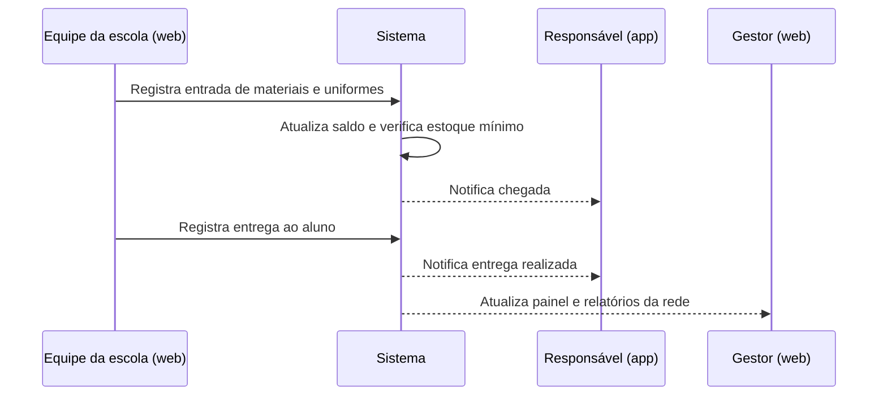
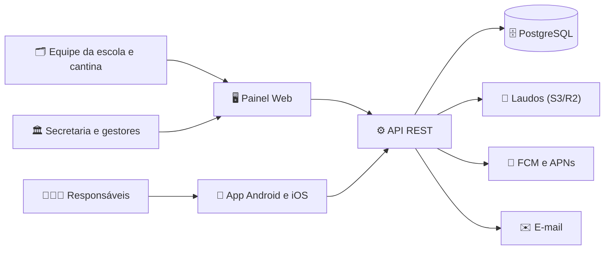

<div align="center">


### Todo o estoque escolar em um só lugar.
Materiais didáticos, uniformes e itens da cantina das escolas municipais de Saquarema/RJ, com painel web para a gestão e aplicativo para as famílias.


[Sobre](#-sobre) · [Problema](#-o-problema) · [Funcionalidades](#-funcionalidades) · [Como funciona](#-como-funciona) · [Tecnologias](#-tecnologias) · [Metas](#-metas) · [Roadmap](#-roadmap) · [Documentação](#-documentação) · [Equipe](#-equipe)

</div>

---

## 📖 Sobre

O **SIGECE** substitui as planilhas manuais de estoque das escolas municipais por **uma única plataforma em nuvem, em tempo real**. Ele controla:

- 📚 **materiais didáticos**
- 👕 **uniformes** (por tipo e tamanho, com histórico de entrega por aluno)
- 🍽️ **itens da cantina** (com alerta de estoque mínimo e validade)

A **equipe da escola** registra entradas e saídas pelo painel web, a **Secretaria de Educação** acompanha a rede inteira e os **responsáveis** são avisados pelo app quando materiais e uniformes chegam.

Como diferencial, o sistema inclui um **módulo de alimentação segura**: o responsável cadastra as alergias do aluno (com laudo médico) e recebe alerta automático quando o cardápio tem conflito.

> 🎓 Projeto de **Práticas Extensionistas Integradoras**, curso de **Engenharia de Software** da **Universidade de Vassouras (Campus Saquarema)**, 2026.
> Cliente: **Prefeitura Municipal de Saquarema**, via Secretaria Municipal de Educação.

---

## ⚠️ O problema

| Hoje | Consequência |
|---|---|
| Estoque controlado em **planilhas individuais**, uma para cada tipo de item | Erros de registro, desperdício e falta de itens |
| Sem visão consolidada da rede | Decisões da Secretaria baseadas em relatórios manuais e lentos |
| Famílias sem como acompanhar a chegada de materiais e uniformes | Dúvidas recorrentes na secretaria das escolas |
| Sem controle individual da alimentação | Alunos com alergias sem garantia de refeição adequada |

**Validado em campo** na Escola Municipal José Bandeira, em duas visitas. A escola confirmou que juntar tudo em um só software é *"interessante e extremamente útil"* e destacou o aviso rápido aos pais como o maior ganho.

---

## ✨ Funcionalidades

<table>
<tr>
<td width="33%" valign="top">

### 📦 Estoque
- Materiais, uniformes e cantina
- Entrada, saída e saldo em tempo real
- Alertas de falta, mínimo e validade
- Entrega por aluno com histórico
- Cálculo de ganhos e prejuízos

</td>
<td width="33%" valign="top">

### 📱 App das famílias
- Chegada e entrega de materiais e uniformes
- Notificações push
- Quadro de mensagens da escola
- Acompanhamento da alimentação
- Android e iOS

</td>
<td width="33%" valign="top">

### 🥜 Alimentação segura
- Cadastro de alergias e restrições
- Anexo de laudo médico
- Alerta automático cardápio × restrição
- Refeição alternativa aprovada pelo responsável

</td>
</tr>
</table>

**E ainda:** painel de gestão da rede, relatórios em **PDF/XLSX**, perfis de acesso (administrador, Secretaria, direção, equipe, cantina e responsável) e registro de atividades.

---

## 🔄 Como funciona



### 🏗️ Arquitetura



---

## 🧰 Tecnologias

| Camada | Stack |
|---|---|
| 🖥️ Web | React, TypeScript, Tailwind CSS |
| 📱 Mobile | React Native (Expo) ou Flutter |
| ⚙️ API | Node.js (NestJS), REST, Docker |
| 🗄️ Dados | PostgreSQL 16, armazenamento de objetos criptografado |
| 🔐 Segurança | JWT, RBAC, Argon2/Bcrypt, HTTPS (TLS 1.3), LGPD |
| 🔔 Serviços | Firebase Cloud Messaging, Amazon SES ou Resend |
| 🔁 DevOps | GitHub Actions, ambientes Dev, Staging e Prod |

---

## 🎯 Metas

| | Meta |
|---|---|
| 🏫 | **80%** das escolas municipais de Saquarema em até 4 anos |
| 👨‍👩‍👧 | **80%** dos responsáveis com acesso |
| ⏱️ | **-40%** de tempo gasto na gestão manual de estoques |
| 🥜 | **100%** dos alunos com restrição devidamente atendidos |
| 🚀 | Expansão para as ~94 escolas do município e municípios vizinhos |

---

## 🗺️ Roadmap

- [x] Levantamento do problema e visitas à escola
- [x] TAP, Plano de Negócios, Pitch e Portfólio
- [x] Landing page
- [x] Requisitos, casos de uso, atividades, classes e DER
- [x] Aplicativo mobile dos responsáveis (primeira versão)
- [ ] Protótipo de telas do painel web
- [ ] MVP do sistema completo
- [ ] Piloto em pelo menos 2 escolas
- [ ] Rollout para 80% das escolas
- [ ] Integração com dados da Prefeitura
- [ ] Expansão para 100% das escolas e municípios vizinhos

---

## 📚 Documentação

| Documento | Conteúdo |
|---|---|
| [📋 Requisitos](docs/requisitos.md) | Requisitos funcionais (RF001–RF034) e não funcionais |
| [🗄️ Modelagem](docs/modelagem.md) | Fluxos, DER e classes do domínio |
| [💼 Negócio e custos](docs/negocio.md) | Modelo SaaS, custos, cenários, F.O.F.A. e riscos |
| 📄 TAP · 🎤 Pitch · 🗂️ Portfólio | Entregas acadêmicas do projeto |
| 🌐 Landing page · 📋 Trello | _adicionar links_ |

---

## 👨‍💻 Equipe

**Grupo SIGECE** · Engenharia de Software · Univassouras, Campus Saquarema

| | |
|---|---|
| ⭐ **Gabriel Moraes Tomaz Pimenta** | Gerente do projeto e líder do grupo |
| **Pedro Miguel de Almeida Silva** | Sub-gerente |
| Gabriel Silva de Oliveira · João Paulo Gonçalves Neves · Juan Pablo Teixeira da Silva · Júlio Cézar Lourenço da Silva · Thiago Cardoso Pereira · Thiago Ribeiro Felix de Oliveira · Rhuan Pierre Borba de Aguiar Caitano · Lucas Sodré Lentz | Integrantes |

**Orientação:** Prof. Dr. André Ricardo de Carvalho Saraiva

---

## 🚀 Como executar

> 🚧 O código ainda está em desenvolvimento. As instruções serão adicionadas aqui.

```bash
git clone https://github.com/gabriel1326/SIGECE.git
cd SIGECE
```

## 🤝 Como contribuir

1. Faça um fork e crie uma branch: `git checkout -b feature/minha-feature`
2. Commit seguindo o padrão: `git commit -m "feat: descrição"`
3. Push e abra um **Pull Request**

## 📄 Licença

> ✏️ Definir com a equipe e o professor (ex.: MIT).

---

<div align="center">

**🏫 Universidade de Vassouras · Campus Universitário de Saquarema**

*Feito para as escolas municipais de Saquarema* 💙💚💛❤️


</div>
