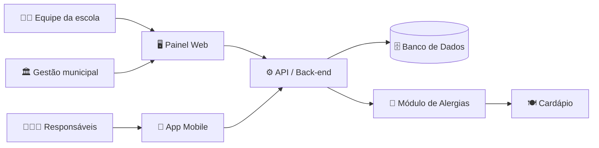

<div align="center">

```text
 ███████╗██╗ ██████╗ ███████╗ ██████╗███████╗
 ██╔════╝██║██╔════╝ ██╔════╝██╔════╝██╔════╝
 ███████╗██║██║  ███╗█████╗  ██║     █████╗
 ╚════██║██║██║   ██║██╔══╝  ██║     ██╔══╝
 ███████║██║╚██████╔╝███████╗╚██████╗███████╗
 ╚══════╝╚═╝ ╚═════╝ ╚══════╝ ╚═════╝╚══════╝
```

### Sistema Integrado de Gestão de Estoques e Consumo Escolar

*Gestão inteligente de cantina, materiais e uniformes das escolas municipais de Saquarema/RJ, com controle de alergias integrado ao cardápio.*

<br>


<br>

[Sobre](#-sobre-o-projeto) •
[Problema](#-o-problema) •
[Funcionalidades](#-funcionalidades) •
[Arquitetura](#-arquitetura-proposta) •
[Requisitos](#-requisitos) •
[Roadmap](#-roadmap) •
[Equipe](#-equipe) •
[Documentação](#-documentação)

</div>

---

## 📖 Sobre o projeto

O **SIGECE** (Sistema Integrado de Gestão de Estoques e Consumo Escolar) é uma plataforma pensada para organizar e dar transparência ao controle de recursos das escolas municipais de **Saquarema, no Rio de Janeiro**.

O sistema reúne em um só lugar o controle de:

- 🍽️ **Estoque da cantina escolar** (alimentos, validade, consumo)
- 📚 **Materiais escolares**
- 👕 **Uniformes**
- 🥜 **Alergias dos alunos**, cruzadas automaticamente com o cardápio
- 📱 **Aplicativo mobile** para os responsáveis acompanharem as informações

> 🎓 Projeto desenvolvido na disciplina **Práticas Extensionistas Integradoras I**, da **Universidade de Vassouras (Univassouras), campus Saquarema**, tendo a **Prefeitura de Saquarema** como cliente.

---

## ⚠️ O problema

Hoje, o controle de recursos escolares tende a sofrer com:

| Dor | Consequência |
|---|---|
| Controle de estoque manual ou descentralizado | Falta ou desperdício de alimentos e materiais |
| Pouca visibilidade do consumo por escola | Dificuldade de planejar compras |
| Alergias dos alunos sem cruzamento com o cardápio | **Risco à saúde e à segurança das crianças** |
| Comunicação limitada com os responsáveis | Famílias sem informação sobre cardápio e uniformes |

---

## 🎯 Objetivos

**Objetivo geral:** oferecer um sistema integrado que organize estoques e consumo das escolas municipais, reduzindo desperdícios e protegendo alunos com alergias alimentares.

**Objetivos específicos:**

- [ ] Centralizar o controle de estoque de cantina, materiais e uniformes
- [ ] Registrar entradas, saídas e consumo por escola
- [ ] Cruzar o cardápio com as alergias cadastradas e gerar alertas
- [ ] Gerar relatórios para apoiar decisões de compra e planejamento
- [ ] Disponibilizar um app mobile para os responsáveis

---

## ✨ Funcionalidades

### 🍽️ Cantina
- Cadastro de itens e controle de estoque
- Registro de entradas, saídas e consumo
- Acompanhamento de validade e nível mínimo de estoque
- Gestão de cardápio

### 📚 Materiais e 👕 Uniformes
- Controle de estoque por escola
- Registro de distribuição
- Histórico de movimentações

### 🥜 Controle de alergias
- Cadastro de alergias e restrições alimentares dos alunos
- **Integração direta com o cardápio**: o sistema sinaliza pratos e ingredientes de risco
- Visão rápida para a equipe da cantina

### 📱 App para responsáveis
- Consulta do cardápio
- Informações sobre o aluno e suas restrições
- Comunicação com a escola

### 📊 Gestão e relatórios
- Painel com indicadores de estoque e consumo
- Relatórios por escola e por período
- Apoio ao planejamento de compras da Prefeitura

---

## 🏗️ Arquitetura proposta



> 🔧 *Diagrama conceitual. Será refinado conforme as decisões técnicas do time.*

---

## 🧰 Tecnologias

> ✏️ **Preencher com a stack escolhida pela equipe.**

| Camada | Tecnologia |
|---|---|
| Front-end web | _a definir_ |
| App mobile | _a definir_ |
| Back-end / API | _a definir_ |
| Banco de dados | _a definir_ |
| Gestão do projeto | Trello |
| Documentação | Markdown / Obsidian |
| Versionamento | Git + GitHub |

---

## 📋 Requisitos

> ✏️ *Lista inicial. Ajustar de acordo com o documento oficial de requisitos.*

### Requisitos funcionais

| ID | Requisito |
|---|---|
| RF01 | O sistema deve permitir cadastrar e consultar itens de estoque |
| RF02 | O sistema deve registrar entradas e saídas de estoque |
| RF03 | O sistema deve cadastrar alunos e suas alergias alimentares |
| RF04 | O sistema deve cruzar o cardápio com as alergias e emitir alertas |
| RF05 | O sistema deve permitir gerenciar o cardápio escolar |
| RF06 | O sistema deve gerar relatórios de estoque e consumo |
| RF07 | O app deve permitir que responsáveis consultem o cardápio |
| RF08 | O sistema deve ter controle de acesso por perfil de usuário |

### Requisitos não funcionais

| ID | Requisito |
|---|---|
| RNF01 | Interface simples e utilizável por pessoas com pouca experiência técnica |
| RNF02 | Proteção de dados pessoais de alunos, conforme a **LGPD** |
| RNF03 | Acesso seguro com autenticação |
| RNF04 | Disponibilidade e desempenho adequados ao uso diário nas escolas |
| RNF05 | App mobile compatível com os principais dispositivos |

---

## 🗺️ Roadmap

- [x] Levantamento do problema e do cliente
- [x] Documentos iniciais (TAP, Plano de Negócios, Pitch, Portfólio)
- [x] Landing page do projeto
- [ ] Documentação de requisitos
- [ ] Diagramas (casos de uso, classes, entidade-relacionamento)
- [ ] Protótipo de telas
- [ ] Desenvolvimento do back-end
- [ ] Desenvolvimento do painel web
- [ ] Desenvolvimento do app mobile
- [ ] Testes e validação com o cliente
- [ ] Entrega final

---

## 🎨 Identidade visual

O projeto usa as cores do **brasão e da bandeira de Saquarema**:


---

## 👥 Equipe

Projeto desenvolvido por uma equipe de **8 estudantes** de Engenharia de Software da Univassouras.

| Integrante | Função | GitHub |
|---|---|---|
| **Gabriel** | Líder do grupo | [@gabriel1326](https://github.com/gabriel1326) |
| _Nome_ | _Função_ | [@usuario](https://github.com/) |
| _Nome_ | _Função_ | [@usuario](https://github.com/) |
| _Nome_ | _Função_ | [@usuario](https://github.com/) |
| _Nome_ | _Função_ | [@usuario](https://github.com/) |
| _Nome_ | _Função_ | [@usuario](https://github.com/) |
| _Nome_ | _Função_ | [@usuario](https://github.com/) |
| _Nome_ | _Função_ | [@usuario](https://github.com/) |

---

## 📚 Documentação

| Documento | Link |
|---|---|
| TAP (Termo de Abertura do Projeto) | _adicionar link_ |
| Plano de Negócios | _adicionar link_ |
| Pitch | _adicionar link_ |
| Portfólio | _adicionar link_ |
| Landing page | _adicionar link_ |
| Quadro Trello | _adicionar link_ |

---

## 🚀 Como executar

> ✏️ *Preencher quando o código estiver pronto.*

```bash
# Clonar o repositório
git clone https://github.com/gabriel1326/SIGECE.git
cd SIGECE

# Instruções de instalação e execução serão adicionadas aqui
```

---

## 🤝 Como contribuir

1. Faça um fork do repositório
2. Crie uma branch para sua alteração: `git checkout -b feature/minha-feature`
3. Faça o commit: `git commit -m "feat: descrição da alteração"`
4. Envie para o seu fork: `git push origin feature/minha-feature`
5. Abra um **Pull Request**

---

## 📄 Licença

> ✏️ *Definir a licença com a equipe e o professor (ex.: MIT).*

---

<div align="center">

**🏫 Universidade de Vassouras · Campus Saquarema**
Práticas Extensionistas Integradoras I

*Feito com dedicação para as escolas de Saquarema* 💙💚💛❤️

</div># SIGECE
trabalho de faculdade
